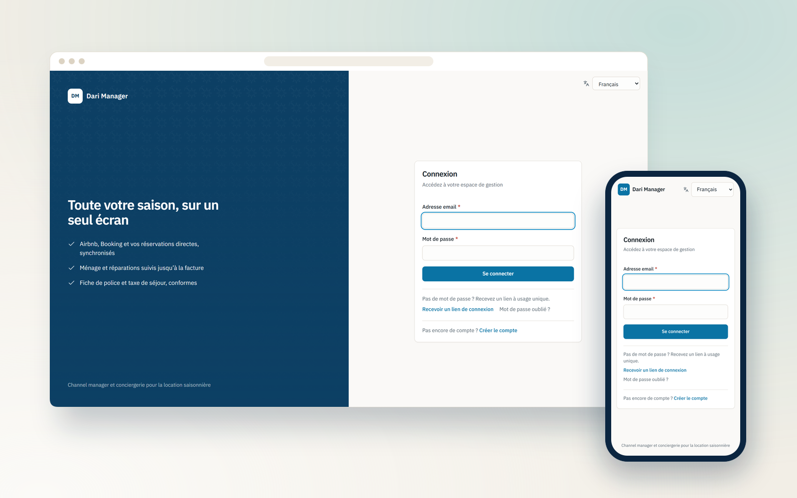
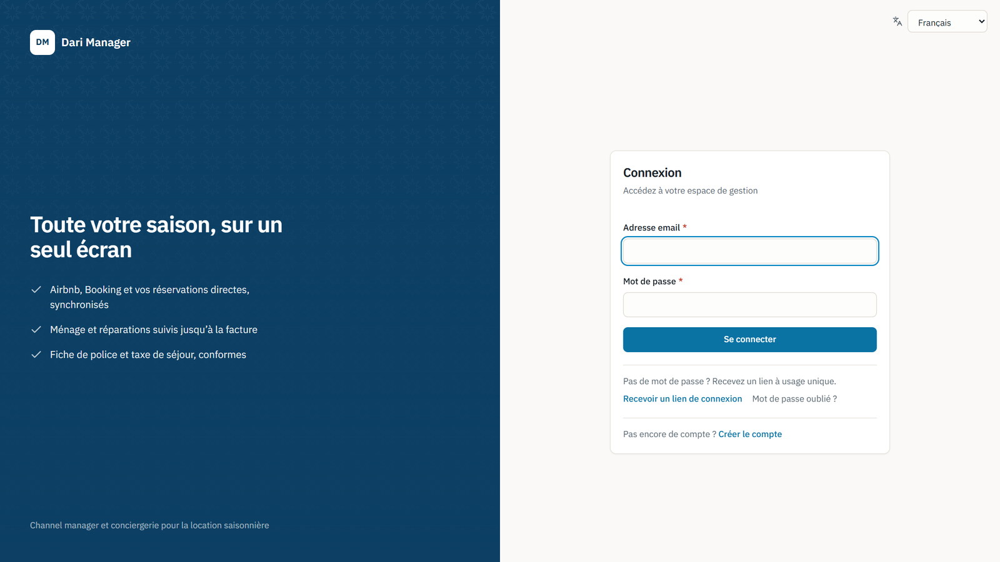
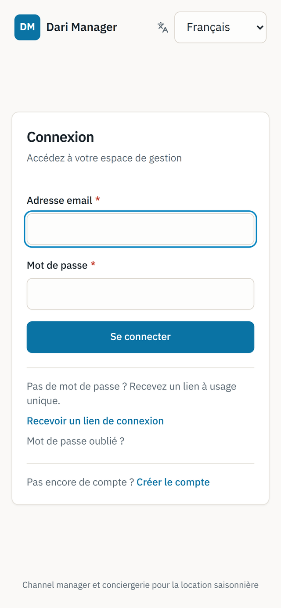

  

<h1 align="center">Dari Manager</h1>

  <b>Channel manager et outil de conciergerie pour la location courte durée en Tunisie.</b>
   
  Channel manager and concierge tool for short-term rentals in Tunisia.

  
  

  
  
  
  
  

---

## Le projet

Un outil multi-entreprise et mobile-first pour les gestionnaires de locations saisonnières. Les calendriers des plateformes sont synchronisés dans les deux sens, les doubles réservations sont détectées, les équipes de ménage suivent leurs checklists depuis leur téléphone, et les finances — charges, taux EUR/TND, taxe de séjour — sont réunies dans un tableau de bord.

## Fonctionnalités

- Synchronisation iCal bidirectionnelle et calendrier multi-logements
- Détection automatique des doubles réservations
- Application ménage (PWA) avec checklists photo et signalements en temps réel
- Finances : charges, taux EUR/TND, taxe de séjour et export comptable
- Check-in voyageur sans compte, passeports chiffrés et fiche de police imprimable

## Aperçu

### Ordinateur

### Mobile

  

## Fiche

| | |
|---|---|
| **Type** | Système sur mesure |
| **Contexte** | Produit SaaS |
| **Année** | 2026 |
| **Rôle** | Conception et développement complets (design, front-end, back-end, mise en ligne) |
| **Technologies** | Next.js · TypeScript · Supabase · Turborepo · PWA |
| **Site** | [darimanager-web.vercel.app](https://darimanager-web.vercel.app) |

## Code source

> [!NOTE]
> Le code source de ce produit est privé. Ce dépôt est une vitrine : il présente le projet, ses fonctionnalités et des captures.
> Pour en discuter ou pour un projet similaire : [portfolio](https://satouri-dev.vercel.app/fr) · [LinkedIn](https://www.linkedin.com/in/abdel-monaam-satouri-054268314).

---

  Conçu et développé par <a href="https://satouri-dev.vercel.app/fr">Satouri Développement</a> · Djerba, Tunisie
   
  © 2026 Abdelmonaam Satouri — Tous droits réservés

